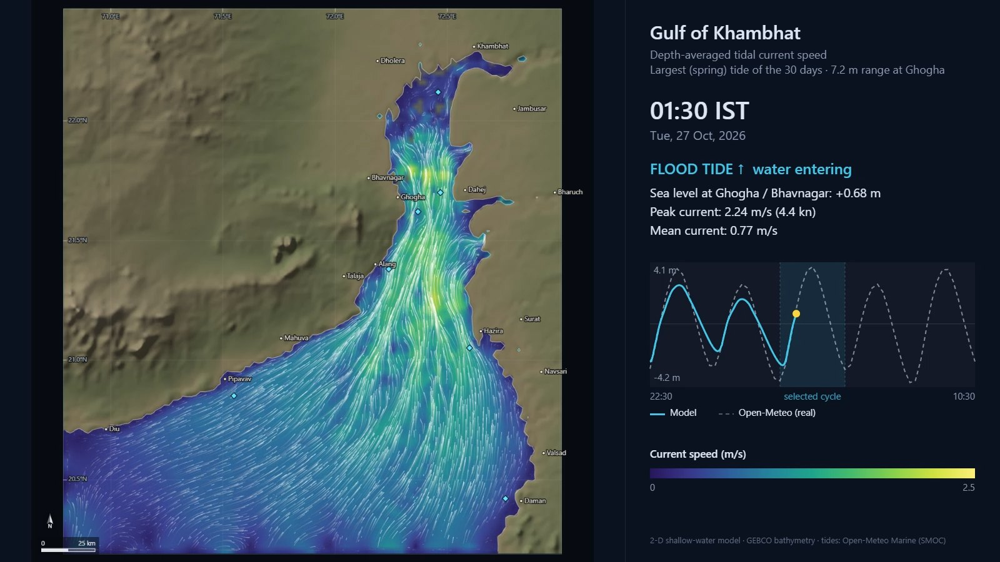
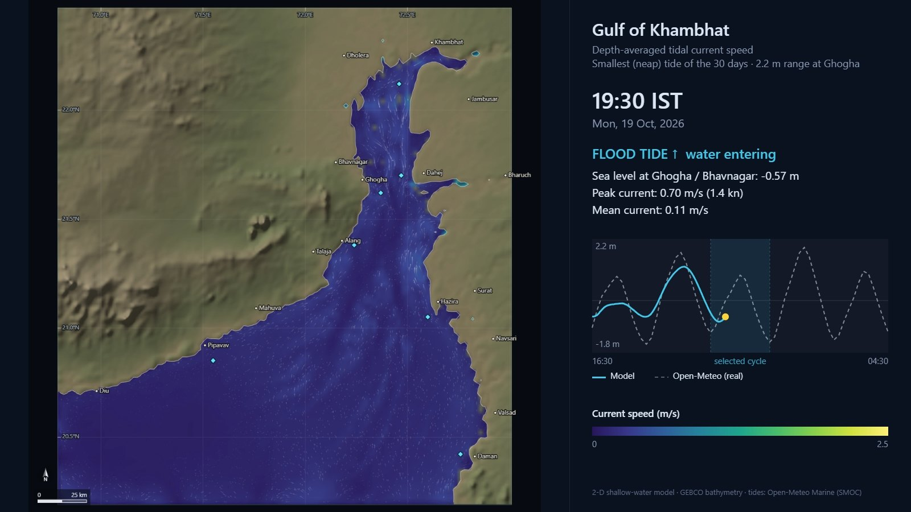
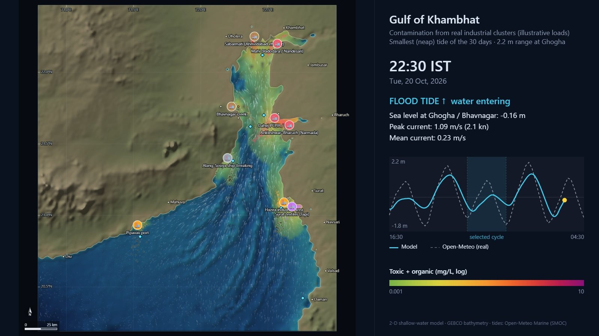
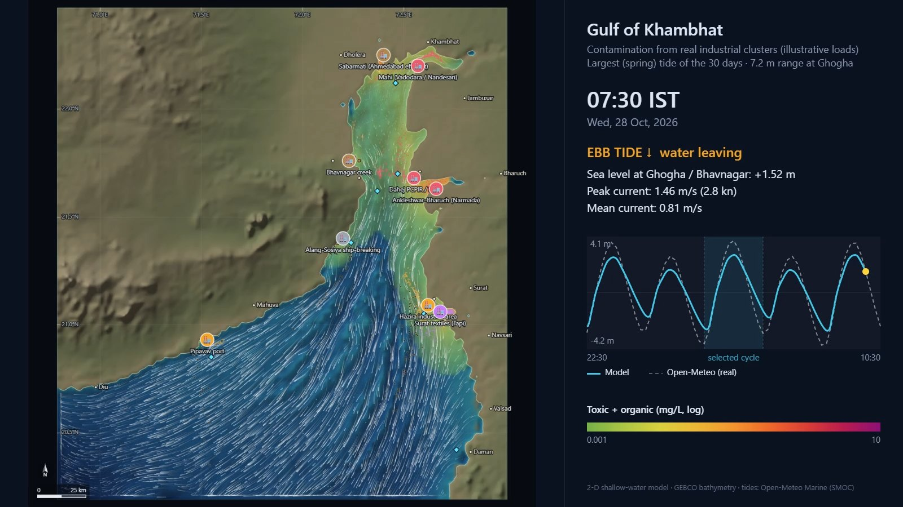

# Gulf of Khambhat — Tide & Pollution Simulator

An interactive browser simulator of tidal currents and contaminant spreading in the Gulf of Khambhat (Gulf of Cambay), Gujarat, India. It is driven by **real data**: GEBCO bathymetry and 30 days of hourly sea level from the Open-Meteo Marine API.

Place polluting industries along the coast, release drifters, trigger spills, and watch how the huge tides (up to ~10 m) slosh water back and forth, trap it in loops, and spread contamination up and down the gulf.


*Spring tide (7.2 m range at Ghogha): flood currents reach ~2.3 m/s, fastest in the narrow upper gulf.*

| Neap tide: currents | Neap tide: industrial pollution |
|---|---|
|  |  |
| Neap tide (2.2 m range): currents drop to ~0.9 m/s. | With weak neap currents, plumes stay bunched near the outfalls. |


*Nine real industrial clusters (Alang, Dahej, Ankleshwar/Narmada, Hazira, Surat/Tapi, Sabarmati, Mahi, Bhavnagar, Pipavav) after 5 days of discharge. Spring tides stretch the plumes far down the gulf. Loads are illustrative.*

---

## Install & run

You need **git** and **Python 3** (only for the local web server) and a modern browser (**Chrome or Edge** recommended; video recording needs WebCodecs). Nothing to `pip install`, no build step.

1. Clone the repository:

   ```bash
   git clone https://github.com/paritosh-human/gulf-of-khambhat-simulator.git
   ```

2. Start a local web server in the project folder:

   ```bash
   cd gulf-of-khambhat-simulator
   python -m http.server 8765
   ```

   (On some systems the command is `python3` or `py`.)

3. Open **http://localhost:8765** in your browser. The simulation starts playing immediately.

> **No Python?** You can also just double-click `index.html`: the data is bundled as a script, so the simulator runs straight from `file://`. Any other static server (`npx serve`, VS Code Live Server, …) works too. If something misbehaves when opened as a file, use a server.

---

## Using the app

**Top bar.** Play/pause (or press `Space`), restart, set the simulation speed (10 min/s up to 1 day/s), and see the current time (IST) and tide state.

**Map tools** (left panel):

| Tool | What it does |
|---|---|
| ✋ Select | Drag to pan, scroll to zoom. Drag an industry to move it. Click a ◆ tide station to plot it in the chart. |
| 🏭 Industry | Click on the water to place an outfall. Choose its type (chemical, refinery, textile, ship-breaking, sewage, power), load (kg/day), and discharge mode (continuous / ebb only / flood only). |
| 🟡 Drifters | Click to release a cluster of drifters. Their trails show how water loops back and forth with the tide. |
| 💥 Spill | Instantaneous spill of 1–1000 tonnes. |
| 📍 Probe | Monitor concentration at a point (shown in the bottom chart). |

**Buttons.** *Load real clusters* adds the nine real industrial areas. *Seed drifter grid* releases drifters across the whole gulf.

**Map layers:**
- **Current speed** and **Sea level**: the instantaneous tide.
- **Contamination**: total, toxic (persistent), or organic (degrading).
- **Water age**: how many days the water has been inside the gulf. High values show where it gets trapped.
- **Residual eddies**: tide-averaged circulation, showing the loops that trap water.

Flow streaks can follow either the instantaneous currents or the tide-averaged currents.

**Physics sliders.** Tide amplitude, bottom friction, organic half-life, wind strength. You can also toggle nonlinear advection and real wind forcing.

**Bottom chart.** Model sea level against real Open-Meteo sea level at the selected station, plus concentration at the probe and wind. Click or drag on it to jump to any time in the 30-day window.

**Stats panel.** Mass released, still in the gulf, flushed to sea and degraded; polluted area; peak concentration; mean water age.

---

## Real data

| What | Source | Where |
|---|---|---|
| Bathymetry & coastline | GEBCO 2020 (15″) via [OpenTopoData](https://www.opentopodata.org/) | baked into `data/gulf_data.js` (2 km grid, 111 × 114) |
| Sea level, 30 days hourly | [Open-Meteo Marine API](https://open-meteo.com/en/docs/marine-weather-api), `sea_level_height_msl` (Météo-France SMOC, includes tides) | 8 open-sea boundary points force the model; 7 ports used for validation |
| 10 m wind | [Open-Meteo Forecast API](https://open-meteo.com/en/docs) | optional forcing (calm if unavailable) |

The bundled data covers **3 Oct – 2 Nov 2026**. To get the latest 30 days, either:
- click **Fetch latest 30 days** in the app (downloads live in the browser), or
- regenerate the bundled file (takes ~3 min):

  ```bash
  python tools/fetch_data.py
  ```

---

## The model

- 2-D depth-averaged shallow-water equations on an Arakawa C-grid (Δt ≈ 33 s).
  - Wetting & drying of tidal flats, Coriolis, quadratic bottom friction, horizontal viscosity, wind stress.
  - Nonlinear advection, which generates the tidal residual eddies.
- Open boundary (south & west edges) clamped to real sea level.
- Tracers (finite-volume, donor-cell): toxic (conservative), organic (first-order decay), and water age.
- Lagrangian particles: drifters with trails, plume particles, oil (with 3 % windage).
- Residual currents are averaged over 2 M2 cycles (24.84 h).

**Validation.** Open `http://localhost:8765/tools/test_model.html`. It runs 3 days headless and compares the tidal range with Open-Meteo at each port.
- Near the mouth (Pipavav, Daman) the model matches within ~0.1 m.
- Inside the gulf it reproduces ~75 % of the tidal amplification. Use the *Tide amplitude* slider to calibrate.

> Industry loads in "Load real clusters" are **illustrative**, not measured discharges. This is an educational / exploratory tool, not for regulatory use.

---

## Recording videos

`js/recorder.js` renders a tidal cycle frame-by-frame and writes a seekable MP4 (WebCodecs H.264, no external libraries). With the app open, run this in the browser console (F12):

```js
// which: 'max' = biggest (spring) tide, 'min' = smallest (neap) tide
// pad: extra cycles before and after; layer: 'speed' | 'contaminant' | 'age' | ...
const r = await Recorder.recordCycle(app, { which: 'max', pad: 2, layer: 'speed', seconds: 60 });
const a = document.createElement('a');
a.href = URL.createObjectURL(r.blob); a.download = 'gulf_tide.mp4'; a.click();
```

For pollution videos, first click *Load real clusters*, then add `preRunDays: 5` and `layer: 'contaminant'` so the plumes are established before recording starts.

---

## Project layout

```
index.html            app page
css/style.css         styles
js/model.js           hydrodynamic + tracer + particle model
js/render.js          map renderer (base map, overlays, particles)
js/colormaps.js       colour scales
js/chart.js           tide / concentration timeline chart
js/livedata.js        live Open-Meteo download
js/app.js             UI wiring
js/recorder.js        MP4 video recorder
data/gulf_data.js     baked bathymetry + 30-day tide/wind data
tools/fetch_data.py   regenerate data/gulf_data.js
tools/test_model.html model validation page
tools/save_server.py  optional local endpoint to save recordings into output/
docs/ARCHITECTURE.md  module interfaces
```
